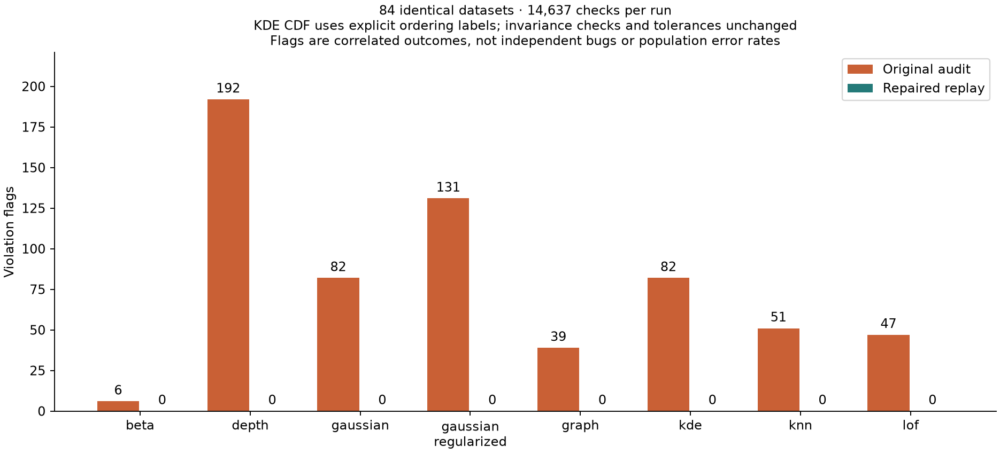

# Numerical consistency repair and validation

Date: 2026-10-18. Working-tree Platypus 0.2.0, Julia 1.13.2, two threads.
The user requested implementation of the panel's numerical consistency findings.
Correctness and internal consistency govern the choices below. Agreement with
human perceptions is outside scope.

## Evidence and acceptance

The original 84-dataset audit remains in
[`validation/consistency/results`](../../validation/consistency/results).
It recorded 14,637 checks: 14,007 passes and 630 overlapping violation flags,
with no unexpected errors. The [subsequent panel review](panel_followup/README.md)
isolated causes rather than treating every flag as an independent bug.

The final repaired replay is saved separately in
[`validation/consistency/repaired_results`](../../validation/consistency/repaired_results).
It passes **14,637/14,637 checks across all 84 datasets**, with **zero violation
flags and zero unexpected errors**. All 630 original flags are resolved under
the declared final contracts, with no new flags. The 1,512 baseline fits comprise
1,464 successes and 48 documented model rejections. Saved inputs, check keys,
seeds and tolerances match the original audit. The KDE CDF contract changes
explicitly as explained below; this is not a claim of an unchanged raw-CDF oracle.

| Method | Original flags | Final flags |
|---|---:|---:|
| Empirical beta copula | 6 | 0 |
| Mahalanobis depth | 192 | 0 |
| Gaussian copula | 82 | 0 |
| Regularized Gaussian copula | 131 | 0 |
| Graph typicality | 39 | 0 |
| KDE | 82 | 0 |
| kNN distance | 51 | 0 |
| LOF | 47 | 0 |
| **Total** | **630** | **0** |



The [comparison table](../../validation/consistency/repaired_results/comparison.csv)
records resolved and new flags separately. The
[artifact verification](../../validation/consistency/repaired_results/provenance.txt)
checks deterministic input reconstruction, result-table integrity and the frozen
source fingerprint. Original results and intermediate failures remain preserved.

The final frozen source passes **3,701/3,701 package assertions**, including the
new mixed-underflow controls and explicit normalization-interface tests.
The independent comparator suite passes another **976/976 assertions**. These
are separate from the broad simulation audit. All eight small oracle replay
checks also pass on the final source. The strict documentation build passes.

The final package suite comprises 17 top-level testsets, including 2,270 binary
rounding controls, 51 depth, 177 density, 162 neighborhood and 130
structural/provenance repair assertions. In the small oracle replay, depth and
constant-KDE errors are zero, and the LOF raw oracle difference is at most
`2.23e-16`. Serial/threaded pair scores agree. The strict documentation build
checks examples, exported docstrings and references.

Independent computational-social-science acceptance finds zero headline changes,
order reversals, tie changes or cutoff switches in all five former defect
fixtures. Its positive-reference control remains sensitive (maximum headline
change `0.481481`, seven illustrative cutoff switches), as it should. The sociology
review passes 33 additional saved controls for ID joins, snapshots, descriptive
labels, score direction and the analytic distinction between zero-query appending
and positive-mass row splitting. See `validation/consistency/repair_panel/`.

First full repair iteration source SHA256:
`db82394061298f3abe5edc4dde3f31f1fff8e843fbc3bd4e32bf8a4c0de08672`.
The original audit used
`65d1035289eda64caf3bd7de0294801e2b1859e6315e70a65e4aacf8a6f4cdcc`.

### Full replay exposed a raw-output representation limit

The first full replay passed 14,635 checks and retained two flags, both real-space
KDE on `zero_inflated_2026` after common unit changes `2^-200` and `2^200`.
All inputs, outputs, checks and its source fingerprint are preserved in
[`repair_iterations/first_full`](../../validation/consistency/repair_iterations/first_full).
Its artifact integrity check passed. It resolved 628 original flags; it was not
accepted as complete. That iteration passed 3,616 package assertions across
15 top-level testsets, before the final KDE representation and underflow repairs.

Two independent 512-bit Gaussian-kernel evaluations established that entities
41 and 49 have genuinely unequal densities, with log-density difference
`3.92195232652148e-16`. Changing physical units adds a common log-density constant
of magnitude about 277. Float64 spacing at that magnitude cannot retain their
distinction. Factoring the bandwidth term out of a Float64 log sum still erases
it. A global tolerance or consistently tied output would conceal a real contrast.
See the [independent mathematical diagnosis](../../validation/consistency/repair_panel/mathematics_final/findings.md).

The final correction therefore makes the normalization representation explicit.
Real-coordinate KDE accumulates dimensionless Gaussian kernel masses from the
original weights and represented exponential terms using exact rational sums.
It compares those sums before any final Float64 mass rounding and exports dense
ordinal labels in `normalization_scores`. These labels carry order and equality,
not density units. Extremely small masses require a scaled representation and
a common comparison policy. Kernel evaluation remains finite precision; this
is not an arbitrary-precision proof of all transcendental comparisons.

`raw_scores` continues to report physical-unit Float64 log densities. Its rounded
ties can now have different percentiles when the separate ordering resolves a
genuine distinction. Rank-space KDE and the other pair methods use raw scores as
their normalization values. `scoretable(result; normalization=true)` exposes the
values used, and `normalization_basis` records the policy. A compact four-point
fixture has an independent 512-bit ordering oracle and preserves genuinely
different percentiles even when physical raw logs collide under unit changes.

**The normalization contract and its audit oracle change explicitly.** The
weighted mid-CDF is now checked against public `normalization_scores`, instead
of assuming every method ranks rounded physical raw output. All physical raw
unit-adjustment checks, representation-invariance checks, generated inputs,
check coverage and tolerances are retained. This is a justified API contract
correction, not an unchanged raw-CDF claim. The final comparison records it.

### Acceptance caught an invalid underflow ordering shortcut

An intermediate implementation put every all-underflow row below every row
with a positive represented mass. The independent social-science reviewer found
that a tiny weight invalidates this shortcut. With coordinates
`[0 0; 100 0; 38 0; 139 0]`, bandwidth one and weights
`[1e-20,1,0,1e-10]`, the zero-mass query's true percentile is approximately
`1e-20`, but the shortcut returned one. An independent 2048-bit oracle separates
the relevant log masses by about 7.55, so this is not a close-score ambiguity.

The intermediate source `c7c96e892949130fa15a5b859a4f7c8eb1413e5e0e5529b26c7ad450c2c690c5`
passed 3,671 package assertions but failed this independent acceptance probe.
Its broad replay was stopped and its logs preserved under
[`mixed_underflow_interim`](../../validation/consistency/repair_iterations/mixed_underflow_interim).
The saved [mixed-underflow oracle](../../validation/consistency/repair_panel/computational_social_science/mixed_underflow_probe.jl)
blocks acceptance of that source. The subsequent correction must compare
ordinary and scaled masses consistently and include the case in regression
tests; passing the earlier suite was insufficient.

One intermediate probe's default-output reexecution overwrote its original CSV.
The earlier failing observation is retained as a clearly labeled
[transcript-derived record](../../validation/consistency/repair_panel/computational_social_science/mixed_underflow_c7_transcript.txt),
not as a recovered original table. The probe now accepts a separate output
directory. The original 630-flag audit and complete first repaired replay were
not overwritten; final independent probe outputs are preserved separately.

The final kernel correction preserves original weights when scaling. A row with
underflowed direct terms uses its maximum **unweighted kernel exponent** as an
offset and sums `original_weight * exp(exponent - offset)` before dividing by
exact remaining reference mass. Half-exponential evaluation followed by rational
squaring extends the range when a shifted exponential still underflows. This
avoids losing small weight-ratio differences through `log(weight)` rounding.
Ordinary rows retain their exact sums of represented direct exponential terms.

Every ordering key therefore represents the same kind of positive number,
`exp(offset) * rational_mass`. Equal offsets use rational comparison directly.
Different offsets reduce to comparing `log(mass_a/mass_b)` with the exact
rational offset difference. Directed MPFR bounds start at 128 bits and refine
until separated; local destinations have explicit precision and rounding, so
the comparator does not alter global arithmetic state; the
[MPFR manual](https://www.mpfr.org/mpfr-current/mpfr.html#Rounding-Modes) was checked
for these rounding semantics. Zero masses are handled
separately. This establishes a coherent strict order for the represented keys;
it does not turn the preceding finite-precision Gaussian kernel evaluation into
an exact real-arithmetic estimator.

The final density regressions pass **177/177** assertions. The independent
[scaled-comparator acceptance](../../validation/consistency/repair_panel/mathematics_final/scaled_comparator_acceptance.md)
passes **976/976** on Julia 1.13.2 with two threads (also independently tested on
Julia 1.10.12 with four threads). It checks complete eight-row weighted-oracle
agreement, genuine 41/49 ordering, directed enclosures, comparisons requiring
more than the initial precision, transitivity, permutation and threaded/caller
precision controls. The final frozen full-source SHA256 is
`a60109d4a70036f7b7474d7a410e105b17f182f869b218332a45e5a0acb05f8c`.
Independent final social-science replay now agrees with every percentile in
both four-row weighted fixtures; all eight recorded errors are zero. The five
earlier defect fixtures also remain clean, while the positive-reference control
retains its expected sensitivity. The intermediate acceptance blocker is closed.

## Causes, repairs and independent controls

| Cause | Implemented repair | Independent acceptance evidence |
|---|---|---|
| Rounded norms decide membership and split rank-lattice ties | Doubled integer midranks; outward-rounded squared-distance filter with exact rational fallback; retain boundary vertex separately from rounded radius | Dense rational distance oracle; five-row LOF fixture; eight-row missing graph edge; genuinely unequal distances that round to one norm |
| Physical log-density rounding loses genuine ordering under unit changes | Preserve raw log densities separately from scale-free kernel-order normalization labels | Independent 512-bit 96-row oracle and four-point collision fixture; underflow-tail controls |
| Depth centering loses represented differences; floating solves split exact equalities | Exact weighted 2×2 covariance and rational depth; one correctly rounded final conversion | Separate rational matrix solve, equal triangle depths, exactly represented large offsets, genuine depth groups about `1e-13` apart |
| Singular support differs between axis-aligned and oblique representations | Exact covariance rank and strict affine support | Off-line zero-weight query before/after exact shear; thin full-rank triangle; rank metadata |
| Density arithmetic breaks identities and coordinate symmetry | Explicit constant-support identity; symmetric product grouping; canonical reflected kernels; exact centered moments | Analytic constant KDE, exact beta-polynomial oracles, product-grid zero covariance, reflection and feature permutations, weak nonzero dependence control |
| Original weights and rounded normalization take different paths | Preserve source weights through transformations, moments and empirical CDF; exact accumulation before final rounding | Weight rescaling, zero-query exclusion, row order, uniform/weighted agreement, original and normalized metadata snapshots |
| Rational conversions inherit ambient BigFloat settings | Integer binary rounding plus exact square-root midpoint verification; no mutable global precision | Normal/subnormal/overflow boundaries, ties-to-even, seeded binary values, 16/53/256-bit caller settings and threaded fits |
| Duplicate/missing pairs silently alter aggregation | Require complete unique all-pairs coverage and coherent source/transform provenance | Public estimators reject malformed collections; complete pair reorder is a positive control |
| Exported reference weights lack identity binding; requested backend obscures actual execution | Detached entity IDs and original/normalized weights; requested/effective backend and geometry metadata | Permuted input IDs, mutation isolation, pair/graph/outcome metadata tests |

The weighted empirical mid-CDF formula was correct conditional on supplied raw
scores. Its argument is now the explicit normalization representation, because
physical Float64 raw logs cannot satisfy all ordering invariants. The repair
also addresses upstream identities and geometry and makes weight arithmetic
exact. It does not introduce approximate equality buckets.
Genuinely unequal near-ties remain distinct when the Float64 output can resolve
them; distinctions below that output resolution can still round together.

## Algorithm comparison and choices

The panel retained the method families: original tie-inclusive LOF, kth
distance, product KDE, Mahalanobis centrality, Gaussian and empirical beta copula
density, and a separate full-feature self-tuning graph. Substituting a different
detector would not fix the demonstrated numerical contracts. Depth's rank and
support policy changes intentionally, as detailed below; its outputs are not
universally equivalent to the former thresholded estimator.

For neighborhood decisions, [Shewchuk's robust-predicate research](https://www.cs.cmu.edu/~quake/robust.html)
motivates a fast certifying filter followed by exact arithmetic for uncertain
comparisons. The implemented filter is derived for squared distances; it is not
his orientation/incircle code. Approximate retrieval and a larger radius epsilon
were rejected because neither certifies the required exact neighborhood.
Neither requested KD-tree nor brute-force mode currently has certified tree
pruning, so both execute the filtered exact scan. This deliberately favors
correctness over acceleration; metadata and documentation disclose the choice.

For two-dimensional depth, the exact closed covariance solve preserves equalities
and strict support directly. Shifted floating moments reduce cancellation but
do not certify ties. SVD/QR and eigensolvers remain valuable numerical tools,
but their tolerance-based numerical rank is a different policy from exact
algebraic rank. The old `depth_rtol` spectral truncation was therefore retired
explicitly: numeric arguments throw an actionable error rather than being ignored.

Canonical kernel symmetries and exact low-dimensional moments were preferred to
a global tie tolerance. The beta mixture is checked against independent
Bernstein polynomials, following [Segers, Sibuya and Tsukahara](https://arxiv.org/abs/1607.04430).
Float64 transcendental kernel evaluation remains approximate; no universal
real-arithmetic equality theorem is claimed.

[Julia's numerical documentation](https://docs.julialang.org/en/v1/manual/integers-and-floating-point-numbers/)
was revisited during integration. A local low-precision counterexample showed
that generic `Float64(::Rational{BigInt})` can inherit ambient BigFloat precision.
The new conversion rounds the rational with integer quotient/remainder and
ties-to-even. Square roots use exact rational comparisons against squared
binary rounding midpoints. Neither implementation changes global MPFR state.

## Procedure record

1. Read the preserved audit, independent probes and all seven panel reviews.
   Separate mathematical identities, represented-input geometry and genuine
   sensitivity. Preserve original outputs and their source fingerprint.
2. Assign mathematics, statistics, Julia engineering, HPC and communication
   work to disjoint implementation/report files; integrate the shared reference
   transformation, CDF and provenance path centrally.
3. Reopen primary numerical/statistical sources and compare algorithms against
   the concrete failure mechanisms; document accepted and rejected choices.
4. Add independent exact or high-precision oracles and nearby-unequal controls.
   Repair malformed pair validation and reference identity metadata alongside
   numerical kernels, because these also change exported results.
5. Run focused regressions and an integrated seed-17 replay. The first full test
   attempt exposed an old decimal-rescaling oracle error: rounded decimal scaling
   can genuinely change exact binary distance ties. Retain those decimal fixtures
   under an independent rational geometry oracle; use exact binary scaling for
   the similarity-invariance assertion. No audit tolerances were loosened.
6. Probe extreme zero-weight queries, caller precision and threaded execution.
   Fix rational-to-Float64 and sign-promotion dependence discovered in this step.
7. Freeze production source, replay all 84 datasets into a new directory, run the
   full package suite, rerun small counterexamples, verify saved input/table/source
   integrity, execute documentation, and obtain social-science acceptance review.
8. Investigate the two residual KDE flags with independent 512-bit oracles.
   Prove a physical Float64 log-density collision, add explicit normalization
   labels and a compact unequal-density regression, disclose the changed CDF
   contract, and repeat the complete integration gate on the final source.
9. Publish the before/after counts and limits below; keep historical observations
   identifiable and avoid reinterpreting numerical agreement as substantive validity.

## Reproduction

From the repository root with its Julia 1.13.2 project:

```sh
julia --threads=2 --startup-file=no --project=. test/runtests.jl
julia --threads=2 --startup-file=no --project=. validation/consistency/run.jl /tmp/platypus-repair
julia --threads=2 --startup-file=no --project=. validation/consistency/reproduce.jl /tmp/platypus-repair
julia --threads=2 --startup-file=no --project=. validation/consistency/verify_artifacts.jl /tmp/platypus-repair
python3 validation/consistency/plot_results.py /tmp/platypus-repair
python3 validation/consistency/compare_repairs.py validation/consistency/results /tmp/platypus-repair
julia --threads=2 --startup-file=no --project=docs docs/make.jl
```

In this sandbox the commands use
`JULIA_DEPOT_PATH=/tmp/platypus-review-julia-depot:/home/simon/.julia` so compilation
can write to a temporary depot. That is an execution-environment detail, not a
package requirement. The audit records failures and exits normally; inspect
its status counts rather than equating process exit with correctness. The
historical panel verifier pins the old source hash and is intentionally not
a current-source acceptance test.

## Performance and scope limits

Exact predicates currently require quadratic candidate work; pair scoring retains
linear scratch rather than a dense distance matrix. Graph edges can still be
quadratic with many boundary ties, and `max_edges` remains enforced. Rational
moments and kernels add integer-arithmetic allocation costs. See the
[HPC measurements](numerical_repair_hpc.md) and
[depth measurements](numerical_repair_mathematics.md); cumulative allocations
are not peak memory. No speedup over the previous uncertified tree is claimed.

The package cannot recover precision lost before input reaches it. Arbitrary
decimal rescaling can change represented geometry or weight ratios. Near-singular
but exactly full-rank data now uses full rank rather than spectral truncation.
Copula support restrictions and unsupported weighting combinations remain
documented rejections. Passing finite simulations and independent fixtures is
evidence for the tested contracts, not proof for every possible dataset.

## Panel records

- [Statistics](numerical_repair_statistics.md)
- [Mathematics](numerical_repair_mathematics.md)
- [Julia engineering](numerical_repair_julia.md)
- [Julia HPC](numerical_repair_hpc.md)
- [Science communication](numerical_repair_communication.md)
- [Computational social science](numerical_repair_computational_social_science.md)
- [Sociology](numerical_repair_sociology.md)
