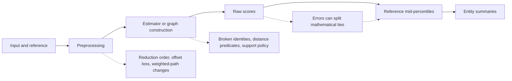

# Panel review after the simulation inconsistencies

**Historical investigation.** Its findings led to the subsequent
[numerical repairs and validation](../numerical_repair.md). The observations and
source fingerprint below remain the pre-repair record, not the current verdict.

Review date: 2026-10-18. Working-tree Platypus 0.2.0, Julia 1.13.2.
This is a renewed investigation and package review, not a numerical repair.
The original simulation evidence remains preserved. Human-perception validation
remains outside scope.

## Assessment

The panel confirms failures in the implementation of the declared numerical
contracts. The evidence does not support signing off numerical consistency.
The main problem is a chain: preprocessing changes represented geometry,
floating arithmetic breaks identities or boundary decisions, and exact ranking
turns some small raw errors into substantial exported-score differences.
There are also defects that change raw scores or graph topology substantially.
Replacing the statistical methods or applying a global rounding tolerance would
not resolve these causes reliably.

The **630 flags are overlapping symptoms**, not 630 independent bugs. Of them,
525 have raw differences within the audit's `1e-10` diagnostic tolerance and
105 exceed it. Small differences do not establish mathematical equality. The
panel used exact rational calculations, high-precision evaluation, and isolated
changes to particular calculation steps to determine causes on selected cases.
It has not assigned a proven cause to every individual flag.



## Confirmed numerical causes

| Finding | Location | Causal evidence and consequence |
|---|---|---|
| Mathematical score ties are not preserved through estimation and normalization | `src/estimation.jl:80–101`, raw estimator paths | Exact triangle depths are all 1/3; rank-transformed public typicalities become approximately 0.8333, 0.5, 0.1667. An exact beta-polynomial oracle independently confirms broken endpoint ties. |
| Constant-support KDE fails to preserve an algebraic identity | `src/density.jl:113–140` | Three identical weighted points should have log density 0 and typicality 0.5. Independently rounded log-sum expressions produce three different scores. |
| Coordinate order changes arithmetic grouping | `src/density.jl:133`, `:137`, `:163`, `:223` | Changing only three expression groupings in an isolated prototype eliminates all **91** saved KDE/Gaussian feature-order flags, with exactly equal raw values between coordinate orders. No production source was changed. |
| Rounded distances are used as exact neighborhood predicates | `src/neighbors.jl:46–72`; `src/pairs.jl:60–64` | Rank-coordinate rounding splits intended ties. Separately, an exact integer 8×3 fixture loses a graph edge through sequential `hypot`; reversing features restores it, changing typicality by 0.125. Exact frozen-input checks also find distinct distances collapsed into ties. |
| Moment and preprocessing paths lack a common numerical guarantee | `src/pairs.jl:71–79`, `:105–150`; `src/estimation.jl:122–126`; `src/density.jl:218–230` | Freezing transformed coordinates removes grid row-permutation differences. An origin-shift intervention reduces the large-offset depth error from 0.00564011 to about 1.11e-16. A factorized Gaussian grid acquires nonzero correlation after zero-weight rows switch preprocessing paths, despite an exact zero-covariance oracle. |
| Singular support uses incompatible policies in different coordinate representations | `src/estimation.jl:115–118`, `:137–153` | An exactly off-line, zero-weight query receives depth 1; an exact invertible shear aligning the same support with an axis produces depth 0. One branch uses exact equality, the other a `sqrt(depth_rtol)` tube. |

These are high-priority correctness findings because they can change published
entity orderings under operations that preserve the declared target. Severity
describes consequences, not estimated prevalence in empirical applications.

The empirical mid-CDF formula is **correct conditional on its input floating
scores**. Calling it an incorrectly implemented CDF would obscure the actual
design gap: the package has no sufficient contract linking those computed
scores to mathematical identities, equality, and ordering. Sorting summands
makes a reduction reproducible for a fixed multiset, but does not make it exact
or preserve symmetry in preceding arithmetic.

## Additional package-review findings

**High: pair-collection validation permits silent aggregation changes.**
`_validate_pairset` in `src/types.jl:251–280` validates each entry but does not
require unique pair keys or complete coverage of the documented all-pairs set.
Replacing the second of three pairs with the first is accepted by all six
pairwise method/family configurations in the Julia probe. Their surviving raw
and normalized columns are exactly the original columns `[1,1,3]`; this isolates
the cause from floating noise. Headline atypicality changes by up to **0.583333**.
A manually constructed set missing a pair is accepted too. Reordering the full
unique set is an exact passing control. This affects manual construction or
mutation; ordinary `build_pairs` initially produces a complete valid set.
Require unique, complete pair coverage, or expose a separately specified subset/
pair-weighting API rather than silently changing the documented estimator.

**Medium: exported weights lack an identity binding.** The result object keeps
IDs, but `analysis_metadata` exports only positional reference weights. Sorting
the exported summary table can lose their association. A four-entity probe
demonstrates four incorrect positional matches, while the live result remains
correct. Save ordered IDs with membership weights or export an ID/weight table;
test reconstruction after sorting and joins. This is an export/provenance gap,
not a demonstrated fitting misalignment. Graph fits currently support uniform
weights, so their individual-weight ambiguity has no current numerical effect.

**Lower-priority validation/provenance gaps:** an inconsistent manually
constructed rank `PairSet` without source provenance passes validation and then
fails inside copula fitting with a `MethodError` instead of a targeted rejection.
Pairwise results record the requested KD-tree backend even when extreme dynamic
range causes a brute fallback; the graph result already records its effective
backend. Distinguish requested versus effective settings consistently. Snapshot
and detached-accessor controls passed in the Julia review.

Documentation also needs its status claims reconciled with this evidence.
Historical passing tests remain valid records of those executions; the earlier
closure table is not current proof that weights, ties and support behavior are
resolved. Detailed locations and replacement wording are in the communication
review. No public estimator contract was silently rewritten during this review.

## Consequences and legitimate sensitivity

Focused public-API comparisons establish **headline** consequences independently
of the original audit's maximum across several summary types: LOF reflection
reverses three strict entity orderings, graph feature reversal reverses two, and
adding excluded rows to the Gaussian product grid creates distinctions across
all 25 original entities. The computational-social-science report records the
aligned values and explicitly illustrative threshold comparisons. It does not
claim measured changes in real-world conclusions or outcome-regression bias.

In the original audit, 603 flags exceed tolerance in at least one summary;
27 do not (25 raw-only, two pair-only). A summary change is not automatically a
headline-atypicality change. The original table must not be relabeled as one.

The reference and measurement definitions are otherwise substantially coherent:
changing positive membership, feature schema, bandwidth, k, or method can
legitimately change the target. A sociology control proves analytically that
splitting positive mass across duplicate rows changes kernel-only leave-one-out
KDE, even at fixed bandwidth. That is not a numerical defect. Required invariance
to excluded rows must not become an invalid general replication-invariance test.

## Why a blanket numerical tolerance is not an acceptable repair

The mathematics panel supplied a passing counter-control. Four exactly
representable observations
`(-1,-1), (1,-1), (1,1), (-1,1+2^-40)` have two genuinely distinct rational
depth groups separated by about **1.01e-13**. Their correct percentiles are
`[0.25,0.75,0.75,0.25]`, which the current implementation returns. Merging all
scores within `1e-12` would introduce an error.

Likewise, the HPC oracle finds distinct exact distances that already collapse
to the same floating distance. Expanding all boundaries by an arbitrary epsilon
can add further incorrect neighbors. Approximate equality is not transitive;
any uncertainty-based grouping would need explicit, deterministic semantics
and would change the score contract. More precision can improve a calculation
without certifying exact equality of transcendental scores.

## What the new evidence adds

- **Intervention rather than association:** the statistics prototype changes
  only arithmetic grouping and replays all 91 relevant saved flags. The graph
  probe freezes preprocessing to separate geometry changes from subsequent
  search. The depth probe shifts an exactly represented origin and checks the
  expected answer independently.
- **New independent expectations:** rational covariance and singular-support
  predicates; a rational-polynomial beta density; zero covariance on a Cartesian
  product even for the actual rounded normal scores; rational squared-distance
  neighborhoods with high-precision graph affinities.
- **Controls against overcorrection:** genuine close-but-unequal scores, exact
  weighted simplex depths, frozen coordinates, and comparisons separating
  intended rank/lattice geometry from the literal stored Float64 geometry.

On the saved z-score grid, reordering rows changes 32 edges and graph typicality
by 0.25. Comparisons against the ideal lattice alone require care because its
saved thirds are non-dyadic. The separate integer fixture and exact rational
oracle on frozen Float64 coordinates establish distance-predicate defects
without relying on that ideal-grid interpretation. The five-row LOF defect
does not itself change the union graph: union restores its missing directed
relations. These distinctions are retained in the HPC report.

## Repair sequence and acceptance conditions

1. **Set the numerical contracts.** Distinguish exact identities, numerical
   uncertainty, rank truncation, and query-support tolerance. Specify intended
   transform geometry versus literal floating input semantics. Record effective
   numerical rank and any fallback or approximation policy.
2. **Apply local identity/symmetry repairs first.** Constant-support KDE and
   coordinate-symmetric expressions have direct proofs and focused regression
   cases. The isolated prototype is evidence for a repair, not a completed repair.
3. **Coordinate preprocessing and moment changes.** Compare stable shifted,
   corrected two-pass or pairwise calculations; reconcile uniform reference
   support with weighted paths; handle extremes without losing representable
   local differences. Determinism and accuracy must both be tested.
4. **Repair neighborhood decisions.** Preserve integer/doubled-midrank geometry
   where appropriate. Screen filtered exact predicates for arbitrary Float64
   inputs, with safe candidate-search bounds and conservative fallbacks.
   Reproducible norm summation alone is not a proof of exact membership.
5. **Unify singular-support policy.** Separate rank truncation from support
   distance. Preserve the current strict promise or document a deliberate
   tolerance model consistently across coordinate orientations.
6. **Validate the whole path.** Check preprocessing, raw parameters, raw scores,
   topology, final percentiles, and downstream ordering independently. Preserve
   close-but-unequal controls. Validate pair-set completeness and export identity
   binding alongside numerical behavior. Promote each minimal defect to regression coverage
   as it is repaired, and rerun the original audit into a new output directory.
7. **Then assess performance.** Benchmark accurate replacements on ties,
   dimensionality, dynamic range, allocation/peak-memory costs and threading.
   Adding an approximate search or a different estimator would change the
   statistical target and cannot serve as evidence that this implementation is
   corrected.

SVD/rank-revealing QR, stable moments, and adaptive exact predicates were screened
as targeted candidates, not adopted production algorithms. The robust-predicate
principle in [Shewchuk's primary work](https://www.cs.cmu.edu/~quake/robust.html)
supports resolving uncertain geometric decisions adaptively; its orientation
and incircle routines are not a drop-in distance comparator. Exact/reproducible
summation approaches are relevant to reductions, but do not restore information
lost earlier in a calculation; see the primary analysis by
[Demmel and Hida](https://people.eecs.berkeley.edu/~demmel/AccurateSummation.pdf).
Specialist notes contain the other sources actually consulted and the associated
algorithm tradeoffs.

## Validation and procedure record

The existing suite was rerun on Julia 1.13.2 with two Julia threads:
**911/911 assertions passed**. The first attempt encountered read-only depot
extension-cache errors despite passing assertions. Repeating with a writable
temporary depot completed cleanly. The retained
[test log](../../../validation/consistency/panel/integration/existing_suite.txt)
and [environment record](../../../validation/consistency/panel/integration/environment.txt)
state the command and unchanged source fingerprint.

That result is compatible with the newly reproduced defects: the suite's
conditional-CDF checks, shared floating backend comparisons, smooth examples,
and selected invariance fixtures do not establish exact boundary handling or
all mathematical identities. No new failing case was hidden by widening a
test tolerance, and no original audit CSV was overwritten.

The panel worked in specialist waves under the concurrent-agent limit. Each
reviewer read the applicable contracts and original evidence, recorded source
locations and primary sources, challenged assumptions, and saved independent
probes where appropriate. The lead cross-checked the causal claims, the ideal
versus literal-input oracle distinction, and the small-raw-difference caveat.
The panel's findings are a review of this working tree; they are not a claim
that every input, platform, supported runtime, public mutation, or estimator
has been exhaustively validated.

## Specialist records

- [Statistics](statistics.md): density/copula identities, arithmetic grouping,
  exact oracles, and reference-weight semantics.
- [Mathematics](mathematics.md): depth, singular support, conditioning, and a
  counterexample to blanket approximate ties.
- [Julia HPC](hpc.md): exact graph oracle, distance predicates, preprocessing
  isolation, backend limits, and performance acceptance conditions.
- [Julia engineering](julia.md): pair-set validation, manual-construction
  errors, snapshots and actual-backend/export provenance.
- [Computational social science](computational_social_science.md): audit
  validity, headline ordering, earlier recovery evidence and repair evaluation.
- [Sociology](sociology.md): reference/record semantics, required invariances
  versus target changes, and entity-to-weight provenance.
- [Science and technology communication](communication.md): claim/evidence
  consistency, public wording and disclosure requirements.

Each numerical specialist report gives its probe command. These investigative
scripts verify their oracle premises and retain current discrepancies; successful
exit does not assert that the package passed. The existing 911-test suite is
reported separately above.

The lead also verified all seven report files and their local links, the
unchanged source fingerprint, reported flag counts, the 91-case intervention
table, and the retained clean suite totals. This artifact check is reproducible:

```sh
python3 validation/consistency/panel/verify_review.py
```

Its [record](../../../validation/consistency/panel/integration/review_integrity.txt)
does not assert resolution of the numerical defects.

The original [simulation report](../simulation_consistency.md) and
[reproduction instructions](../../../validation/consistency/README.md) remain
the starting point for the 84-dataset evidence. New specialist probes and their
outputs are under `validation/consistency/panel/`, separate from that baseline.
