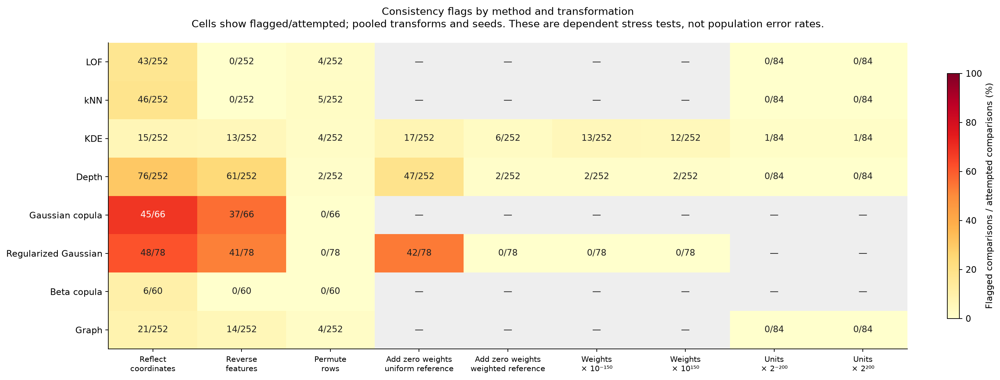
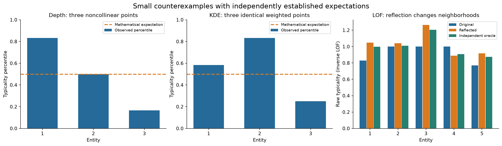
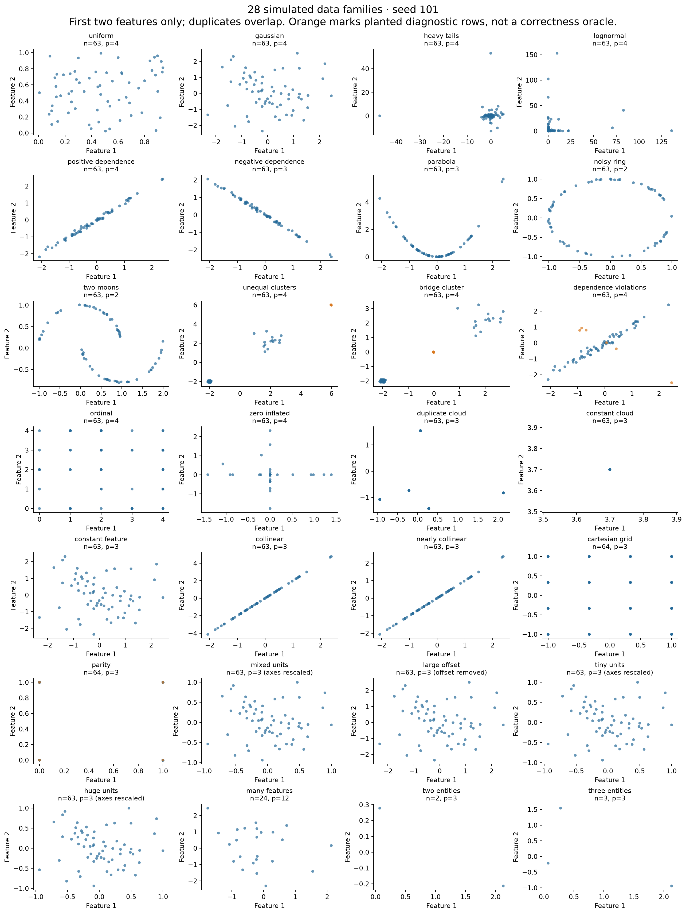

# Simulation audit: unresolved internal inconsistencies

**Historical audit.** This report preserves the original failing implementation's
observations. See [numerical repair and validation](numerical_repair.md) for the
subsequent fixes and separate replay. Original result files remain unchanged.

Date: 2026-10-18. Runtime: Julia 1.13.2, two Julia threads, working-tree Platypus
0.2.0. Source fingerprint and dependency details are saved with the
[results](../../validation/consistency/results/). This investigation follows the
earlier correctness work and runtime migration. It does not revise the package
estimators; the findings below remain unresolved.

The subsequent [seven-specialist panel review](panel_followup/README.md)
investigates causes with independent oracles and isolated interventions, adds
singular-support and pair-validation defects, and records repair acceptance
criteria. Its evidence extends this original audit without overwriting it.

## Outcome

The audit generated **84 datasets in 28 families** and attempted **1,512 baseline
fits** across eight method configurations. Of these, 1,464 succeeded and 48
were documented model rejections: 24 beta-copula fits with ties, 18 unregularized
Gaussian fits with constant margins or singular dependence, and six regularized
Gaussian fits with constant margins. There were **no unexpected baseline or
comparison errors**.

The full investigation recorded **14,637 checks: 14,007 passes and 630 violation
flags**. These are dependent checks and often share a numerical cause; they are
not independent estimates of failure probability or a count of distinct bugs.
Additional small fixtures established mathematical expectations independently
and recorded seven violations and one passing control.

| Method/configuration | Checks | Flags | Largest change in a normalized output |
|---|---:|---:|---:|
| LOF | 2,277 | 47 | 0.793651 |
| kNN | 2,277 | 51 | 0.562500 |
| KDE | 3,033 | 82 | 0.876285 |
| Mahalanobis depth | 3,033 | 192 | 0.750000 |
| Gaussian copula | 462 | 82 | 0.100000 |
| Gaussian copula, regularization 0.05 | 858 | 131 | 0.940000 |
| Empirical beta copula | 420 | 6 | 0.333333 |
| Graph typicality | 2,277 | 39 | 0.572917 |

The last column is the maximum over pair typicality and normalized summaries,
so it is not necessarily the change in headline atypicality. Check counts and
input requirements differ between methods; this table is not a method ranking.



## Independently confirmed defects

### 1. Numerical noise becomes substantial percentile distinctions

For the three observations `(0,0)`, `(1,0)`, `(0,1)`, exact rational arithmetic
gives population-covariance Mahalanobis distance squared **2 for every row**.
Thus depth is **1/3 for every row**, and each reference mid-percentile should be
**0.5**. Rank transformation preserves the noncollinear three-point geometry
relevant to this result.

The rank-transformed implementation returns depths
`[0.3333333333333337, 0.3333333333333332, 0.33333333333333315]`, then typicality
percentiles **[0.833333, 0.5, 0.166667]**. Raw-coordinate fitting also breaks the
tie. These raw errors are small; the resulting distinctions are not.

`_score_percentiles` groups by exact floating-point equality. Its empirical-CDF
arithmetic is consistent with the raw values it receives, but it amplifies
numerical noise where the mathematical scores are tied. The independent
mid-CDF checks all pass for this reason: they validate normalization conditional
on computed raw values, not the accuracy of those raw values.

The broad audit shows the same failure pattern across methods. For example,
adding two zero-weight rows to `cartesian_grid_2026` changes regularized Gaussian
copula normalized outputs by **0.94**, while the maximum raw difference is
approximately **7.06e-17**. Switching from uniform to weighted preprocessing
introduces small coordinate differences that are magnified by ranking. The
small depth example establishes the tie defect independently; the attribution
of every broad-audit flag to this mechanism still needs individual investigation.

### 2. Identical weighted observations receive different KDE scores

Use three copies of `(1,1)` and reference weights `[1,2,3]`. Under the package's
documented reduced-support convention, both coordinates are constant, density
is one on that support, log density is zero, and every mid-percentile is 0.5.

Observed raw log densities are approximately
`[2.78e-17, 1.67e-16, -1.11e-16]`, producing typicality percentiles
**[0.583333, 0.833333, 0.25]**. Leave-one-out log-sum arithmetic does not preserve
the exact constant-support identity. This supplies a second direct oracle for
the raw-tie/normalization problem, with a separate estimator-level correction.

In the full audit, multiplying all reference weights by the same positive
constant changes KDE normalized outputs by as much as **0.876285** on an
identical cloud. Multiplication and renormalization can round floating weights
slightly, but an identical-cloud density must remain constant for *any* positive
weights, making this example unambiguous.

### 3. Rank-space ties alter LOF neighborhood membership

Use these five rows with `transform=:rank` and `k=2`:

```text
1  2
2  4
3  5
4  3
5  1
```

All marginal ranks are untied. Squared distances between the integer ranks
identify the exact neighborhoods; the common rank scaling does not change
membership. Reflecting both coordinates preserves every distance.

| Entity | Exact neighborhood | Original implementation | Reflected implementation |
|---|---|---|---|
| 1 | 2, 4 | 2, 4 | 2, 4 |
| 2 | 1, 3, 4 | 3, 4 | 1, 3, 4 |
| 3 | 2, 4 | 2, 4 | 2, 4 |
| 4 | 2, 3, 5 | 2, 3 | 2, 5 |
| 5 | 1, 4 | 1, 4 | 1, 4 |

The original LOF definition includes every observation within the kth-distance
boundary, including ties. The independent oracle uses exact integer squared
distances for membership and 256-bit arithmetic for reachability and LOF.
Both package fits disagree with it: the maximum inverse-LOF error is **0.205447**
before reflection and **0.058826** afterward. Typicality percentiles change by
up to **0.6** under reflection.

The implementation's final `distance <= radius` predicate compares floating
distances exactly. Rounded rank coordinates can split geometrically equal
distances. The expanded KD-tree candidate radius does not fix the final
membership decision. Both search backends share that predicate and agree with
each other, so backend agreement does not establish mathematical correctness.

The graph estimator uses the same neighborhood machinery. Its broad-audit
flags include actual stationary-mass differences, as well as amplification of
tiny mass differences by normalization. For example, permuting
`cartesian_grid_101` rows under z-score preprocessing changes stationary mass
by **0.002856** and graph atypicality by **0.25**. A separate exact graph oracle
was not developed in this audit.

### 4. Large offsets degrade depth accuracy without input information loss

The small fixture in `reproduce.jl` has five rows with coordinates that are
multiples of 1/64. Adding `1e14` to both coordinates preserves every input
difference exactly: subtracting the offset recovers the original matrix with
bitwise equality. Exact rational covariance calculations give identical depth
before and after the translation.

The centered package fit agrees with the rational oracle within **5.56e-17**.
The translated fit has maximum absolute depth error **0.00564011**. For entity 5,
the exact depth is **0.40736870818434706** and the translated result is
**0.4017285974326292**. This particular fixture's percentiles remain unchanged;
the raw-score defect is still present.

Scaling coordinates by their large absolute maximum before subtracting their
mean loses precision in the small deviations. Related moment calculations in
z-score preprocessing and KDE bandwidth selection merit review too. The broad
audit records row-order and zero-weight inconsistencies on large-offset data;
it does not establish a separate exact oracle for every affected method.



## What passed, and what that establishes

- 1,464 finite/bounded-output checks and 1,464 independent mid-CDF checks passed.
- 756 KD-tree/brute comparisons and 1,008 serial/threaded comparisons passed.
- 1,464 label/ID changes and 624 increasing monotone recodings passed.
- 252 graph stationarity checks and 45 unweighted constant-cloud checks passed.

These are useful implementation checks with limited scope. In particular,
backend agreement shares the floating-distance predicate, stationarity is
tested against the constructed graph, and the uniform-cloud check does not
cover the weighted constant-cloud defect. Passing them does not supersede the
independent counterexamples above.

Violation counts by transformation were: reflection 300; feature permutation
166; adding zero-weight rows to uniform references 106; row permutation 19;
weight scaling by `1e-150` 15 and by `1e150` 14; adding zero-weight rows to
nonuniform references 8; unit scaling by each of `2^-200` and `2^200` one.

## Procedure and scope

1. Read the estimator, transformation, weight, normalization and graph contracts.
   Construct seeded inputs independently of the fitting implementation.
2. Generate 28 families × three seeds, including continuous/discrete data,
   symmetry, duplicates, degenerate support, dependence, nonlinear geometry,
   higher-order parity, extreme scales and small samples. Preserve all 84 CSVs.
3. Define invariances before looking at outcomes. Align row identities and pair
   names after permutations. Compare raw scores on their appropriate scale:
   kNN distances rescale linearly; KDE log densities receive the active-dimension
   log-Jacobian adjustment under a common change of units.
4. Use absolute tolerance `1e-10` for normalized scores and summaries. For raw
   values, use `abs(a-b)/max(1,abs(a),abs(b)) <= 1e-10`; equal signed infinities
   match. This is a diagnostic threshold, not a claimed numerical error bound.
5. Run a pilot at seed 17, correcting two harness setup mistakes (the EntitySet
   keyword and graph return syntax) before interpreting package results. The
   corrected pilot completed 4,879 checks with 107 flags and no unexpected errors.
6. Run the complete three-seed audit: 14,637 checks, 630 flags. Record documented
   fit rejections separately. Retain per-entity baseline scores, check metrics,
   representative counterexamples and descriptive `k` sensitivity.
7. Inspect failures and search for small fixtures. Fix the depth/KDE examples
   analytically; use a seeded search for the five-row LOF and offset examples.
   Verify independent exact-rational or integer-distance premises and use
   high-precision evaluation where needed. Save the minimal inputs and outputs.
8. Revisit the original LOF definition and Julia's floating-point documentation,
   plot the saved observations, and record findings without altering estimators
   or hiding failures behind looser audit tolerances.

Seeds 17, 101 and 2026 correspond to nominal sizes 32, 63 and 96. Structured
families and the two/three-row cases override those sizes. Therefore seed and
sample size are confounded; this is a stress-test collection, not a factorial
Monte Carlo study. Several families also share rank patterns by construction
(for example Gaussian/lognormal), so their results are correlated.

The study does not test exhaustive parameter combinations, huge-n scalability,
all platforms/Julia versions, held-out scoring, every public mutation path, or
the accuracy of every estimator against an independent oracle. Different
methods' disagreement, sensitivity to `k`, and failure to isolate a planted
group are not themselves labeled bugs. Human-perception validation remains
outside scope.



## Remediation priorities

1. Preserve known exact identities in constant-support KDE and other singular
   cases. Make raw-score accuracy and final tie treatment part of the estimator
   contract. Do not apply an arbitrary global rounding rule that erases genuine
   small differences; approximate tie grouping also needs a transitive policy.
2. Preserve rank-space distance ties through a defensible neighborhood policy,
   ideally using exact rank-lattice comparisons where applicable. Validate both
   backends against an independent mathematical oracle, not only each other.
3. Rework centering/scaling for large common offsets and reconcile uniform versus
   weighted preprocessing paths. Extend exact-oracle fixtures to weighted and
   graph cases before optimizing these paths.
4. Promote the minimal examples to regression tests alongside each repair, then
   rerun this audit into a new directory and compare old/new raw and normalized
   results. Preserve intentional API and numerical-contract decisions explicitly.

These are proposed corrective directions, not completed fixes or a claim that
all 630 flags have one cause.

## Sources revisited

- Breunig, Kriegel, Ng and Sander (2000),
  [LOF: Identifying Density-Based Local Outliers](https://cs.fit.edu/~pkc/ml/related/breunig00sigmod.pdf),
  definitions of kth-distance neighborhoods, reachability density and LOF.
- Julia manual,
  [Integers and Floating-Point Numbers](https://docs.julialang.org/en/v1/manual/integers-and-floating-point-numbers/),
  floating-point spacing, rounding, and arbitrary-precision arithmetic.

The independent depth oracle is derived directly from `Z = X - mean(X)`,
`C = Z'Z/n`, and `depth_i = 1/(1 + Z_i' inv(C) Z_i)` in rational arithmetic;
it does not call the package depth implementation. Reproduction commands and
artifact descriptions are in the [audit README](../../validation/consistency/README.md).
